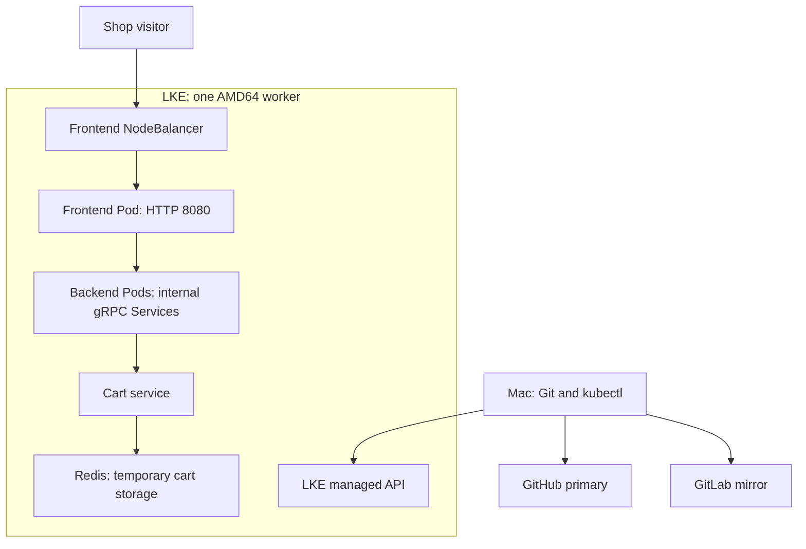

# Deploy Microservices in Kubernetes on Linode LKE

Deploy Google's Online Boutique sample shop with ten application microservices and Redis on Linode Kubernetes Engine. Independently authored Kubernetes manifests configure service discovery, health probes, resource requests/limits, container security and Redis network isolation.

**Status:** application deployment and selected runtime checks completed; paid cloud infrastructure removed after the exercise. The historical demo address is no longer a live endpoint. Final documentation release uses the Git workflow below.

## Assignment and scope

TechWorld with Nana Module 10, Capstone Project 4: deploy a microservices shop using Kubernetes Deployments and Services on Linode LKE, incorporating production and security best practices. Helm, Terraform, Jenkins and application builds are not required by the supplied assignment.

## Architecture



The backend group summarizes application dependencies. The tables below provide the exact Service ports and configured outbound connections. All application resources use namespace `online-boutique`.

## Services

| Component | Service port | Container port |
|---|---:|---:|
| `adservice` | 9555 | 9555 |
| `cartservice` | 7070 | 7070 |
| `checkoutservice` | 5050 | 5050 |
| `currencyservice` | 7000 | 7000 |
| `emailservice` | 5000 | 8080 |
| `frontend` | 80 | 8080 |
| `paymentservice` | 50051 | 50051 |
| `productcatalogservice` | 3550 | 3550 |
| `recommendationservice` | 8080 | 8080 |
| `redis-cart` | 6379 | 6379 |
| `shippingservice` | 50051 | 50051 |

`frontend-external` is an additional LoadBalancer Service on port 80 targeting frontend port 8080.

| Caller | Configured application destinations |
|---|---|
| Frontend | Catalogue `3550`, currency `7000`, cart `7070`, recommendation `8080`, shipping `50051`, checkout `5050`, ads `9555` |
| Checkout | Catalogue `3550`, shipping `50051`, payment `50051`, email `5000`, currency `7000`, cart `7070` |
| Recommendation | Catalogue `3550` |
| Cart | Redis `6379` |

These are Kubernetes Service ports, not necessarily container ports: email maps Service port 5000 to container port 8080.

## Implementation

- Dedicated namespace and explicit namespace declarations.
- Eleven Deployments; eleven internal Services plus one external frontend Service.
- Application images `gcr.io/google-samples/microservices-demo/<service>:v0.8.0`.
- Redis `7.4.2-alpine` pinned to its multi-platform index digest.
- Startup, readiness and liveness probes: gRPC for backend services, HTTP for frontend, Redis CLI ping for Redis.
- CPU/memory requests and limits for every component.
- Non-root UID/GID 1000, RuntimeDefault seccomp, read-only root filesystem, dropped capabilities and disabled privilege escalation.
- No automatically mounted service-account credentials.
- Redis NetworkPolicy permits cart Pods in the same namespace on TCP 6379.
- Separate `k8s/lke/frontend-external.yaml` makes cloud load-balancer creation explicit.
- Local preparation and validation completed before provisioning billable infrastructure.

## Repository organization

| Path | Purpose |
|---|---|
| `k8s/namespace.yaml` | Application namespace |
| `k8s/<component>.yaml` | Deployment and internal Service for each component |
| `k8s/redis-networkpolicy.yaml` | Redis ingress restriction |
| `k8s/lke/frontend-external.yaml` | External LoadBalancer Service |
| `config.yaml` | Unchanged attributed unfinished starting skeleton; do not deploy it |
| `.gitignore` | Local credentials and tooling exclusions |
| `docs/RUNBOOK.md` | Standalone setup, complete file contents, deployment, troubleshooting, recovery, Git release and cleanup |

## Verified outcome

| Check | Evidence and result |
|---|---|
| Manifest validation | Every manifest passed server-side dry-run validation on Minikube. |
| Image references | Registry inspection succeeded for all selected application tags and Redis. Frontend/cart were verified AMD64; Redis supports AMD64 and ARM64. |
| Local Redis | Ready Pod, Service endpoint, PONG inside Redis and from a separate client Pod. |
| Local Redis security | UID/GID 1000; root filesystem write rejected; `/data` write succeeded and test file removed. |
| LKE worker | One AMD64 worker was Ready. API server v1.36.5; worker Kubernetes v1.36.3; client v1.37.0. |
| Application runtime | Eleven Deployments were available with one ready Pod each and zero restarts at the initial inspection. |
| Frontend exposure | LoadBalancer Service received an external IP. |
| Simulated checkout | Checkout logs recorded PlaceOrder, simulated payment success, and simulated email confirmation. |
| Redis isolation | Unlabelled client could not connect to `redis-cart:6379`; logs reported Operation timed out, exit code 1. This supports blocked ingress. |
| Frontend recovery | Rollout restart completed successfully. This tests controlled restart, not node-failure recovery or rollback. |
| Cleanup | Owner confirmed deletion of LKE, worker and NodeBalancer in Cloud Manager; local Minikube profile was stopped. |
| Later inventory | EndpointSlice/PVC/final inventory requests failed after cloud deletion; they were not verified by those requests. |

Browser confirmation of currency switching, the final order page, and cart retention after the frontend restart was requested but not separately confirmed in the recorded outputs. Do not claim those specific checks passed solely from Pod readiness.

## Reproduce the deployment

Follow [the complete runbook](docs/RUNBOOK.md). It includes both a fresh implementation path and a clone-and-redeploy path. For an existing checkout and a new LKE kubeconfig, the deployment sequence is:

```bash
kubectl --kubeconfig="$HOME/.kube/online-boutique-lke.yaml" apply -f k8s/namespace.yaml
kubectl --kubeconfig="$HOME/.kube/online-boutique-lke.yaml" apply -f k8s/
kubectl --kubeconfig="$HOME/.kube/online-boutique-lke.yaml" wait --for=condition=Ready pod --all -n online-boutique --timeout=300s
kubectl --kubeconfig="$HOME/.kube/online-boutique-lke.yaml" apply -f k8s/lke/frontend-external.yaml
```

Run each command separately; resolve errors before the dependent command. Create the namespace first. `-f k8s/` is non-recursive, so it does not create the external Service in `k8s/lke/`. Keep kubeconfig outside the repository.

## Git workflow

[GitHub primary](https://github.com/younghadiz/deploy-microservices-kubernetes) uses remote `origin`; [GitLab mirror](https://gitlab.com/devops-engineering-projects/deploy-microservices-kubernetes) uses `gitlab`.

Create feature branches from `develop`, use conventional commits, validate changes, and merge using `--no-ff`. Push completed work to both remotes. Merge `develop` into `main` at the final release after verified implementation, cleanup and documentation.

| Recorded milestone | Commit |
|---|---|
| Independent baseline | `167d94a12e2a8a4a8f876ec9f570f282d57a5006` |
| Application manifests | `1c7785d` |
| Redis ingress policy | `8f11311` |
| Feature integration into develop | `098217f` |

Deployment commands and Cloud Manager actions do not change tracked files by themselves. Do not create an empty commit merely to record that a deployment occurred.

## Cost control and cleanup

All practicable preparation happened before LKE creation. The sizing recommendation was one Shared CPU worker with 4 vCPUs/8 GB RAM and one NodeBalancer. The exact chosen plan was not separately captured; the runtime output confirms one AMD64 worker. The API hostname identifies region `ca-central-1`.

At the price check on October 13, 2026, the recommended worker was US$0.072/hour and the NodeBalancer US$0.015/hour: about US$0.087/hour combined before taxes and other usage. Recheck [current pricing](https://www.akamai.com/cloud/pricing) before reproducing the project; this is an estimate, not an invoice.

Delete the external Service and verify NodeBalancer removal before deleting LKE. Confirm the worker and any project storage are gone in Cloud Manager. Stopping a VM does not remove its billing. Actual cloud cleanup was confirmed by the owner; Minikube was stopped and its local profile retained.

## Lessons learned

- Kubernetes Services separate stable discovery addresses from replaceable Pod addresses.
- Service ports and container ports can differ, as shown by email.
- Server-side validation proves API acceptance, not image compatibility or runtime success.
- ARM Mac validation and AMD64 cloud execution require architecture awareness.
- Redis security contexts require a writable volume while the root filesystem remains read-only.
- NetworkPolicy requires enforcement by the cluster network plugin and a runtime connection test.
- A rollout restart verifies controlled recovery; it is not a rollback test.
- Deleted-cluster DNS failures must not be mistaken for application failures or proof of complete billing cleanup.

## Limitations and future production work

- This is a working educational deployment with selected production and security practices, not a fully production-ready shop.
- One worker and one replica per component provide no worker-node redundancy.
- Redis has no replication or durable persistence. `emptyDir` is lost with Pod replacement; persistence is disabled and `allkeys-lru` may evict cart keys.
- HTTP exposure has no TLS in this implementation. Payment and email operations are simulated.
- Only Redis ingress is restricted by NetworkPolicy; other application Pods are not isolated by a default-deny policy. Label permissions matter because the rule allows `app=cartservice`.
- Workloads omit service-account tokens, but custom operator RBAC and control-plane ACL configuration were not implemented or verified.
- Application images use version tags, not immutable digests. Redis is digest pinned. Availability was checked; no image vulnerability scan was performed.
- The Redis test's timeout wrapper did not enforce the intended five-second bound. Its observed connection failure, not the wrapper duration, is the recorded evidence.

## Attribution and references

- Original application: [Google Cloud Online Boutique](https://github.com/GoogleCloudPlatform/microservices-demo).
- Training and unfinished manifest skeleton: [TechWorld with Nana](https://gitlab.com/twn-devops-bootcamp/latest/10-kubernetes/helm-chart-microservices), `starting-code`, commit `0b4131e5ac315050b01b5f69ed9d3053adb2642b`.
- Only upstream `config.yaml` was imported, unchanged. Helm files were excluded intentionally.
- Completed Nana `config.yaml` at `96f71295965107a9afb1c73161983194545a5876` was inspected for application scope and configuration comparison; the finished Helm implementation was not copied.
- Application contract reference: [Google's v0.8.0 release manifest](https://github.com/GoogleCloudPlatform/microservices-demo/blob/v0.8.0/release/kubernetes-manifests.yaml).
- Independent manifests, deployment, troubleshooting and documentation: **Gafari Salaudeen**.
- [LKE creation guide](https://techdocs.akamai.com/cloud-computing/docs/create-a-cluster).

The application code was not originally written by this project's author. Third-party attribution does not imply that the upstream repository grants an additional licence beyond its applicable terms.
