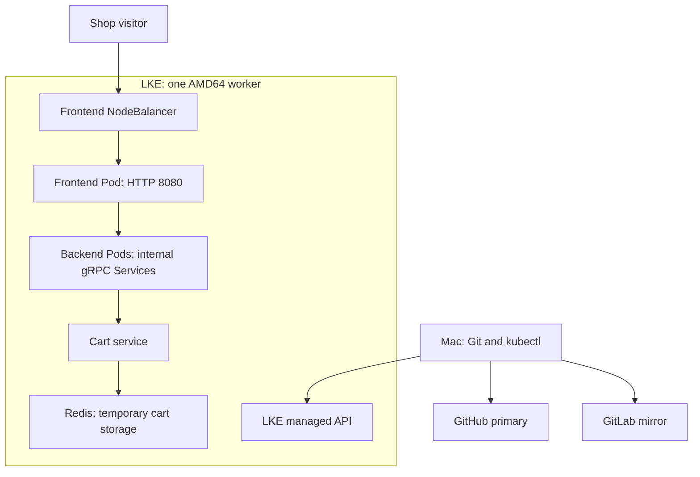

# Deploy Microservices on Kubernetes with Linode LKE

A Kubernetes deployment of **Google Online Boutique**, comprising ten application microservices and Redis. The project demonstrates service discovery, resource management, health checks, container hardening and network isolation on Linode Kubernetes Engine.

- **Author:** Gafari Salaudeen
- **Project:** TechWorld with Nana — Module 10, Capstone Project 4
- **Deployment status:** LKE deployment completed; cloud resources removed after validation.

## Project objectives

- Create Kubernetes Deployments and Services for every component of the online shop.
- Deploy the application to Linode's managed Kubernetes platform.
- Apply selected production and security practices and verify their behaviour.
- Maintain an independent portfolio repository with source attribution, a structured Git workflow and a reproducible operating guide.

## Technology stack

| Area | Technology |
|---|---|
| Orchestration | Kubernetes, Linode Kubernetes Engine |
| Application | Google Online Boutique v0.8.0 container images |
| Cart storage | Redis 7.4.2 Alpine, pinned by image digest |
| Local environment | ARM64 macOS, Docker Desktop, Minikube |
| Deployment tooling | kubectl and declarative YAML manifests |
| Version control | Git, GitHub primary, GitLab mirror |

## Architecture



The backend group summarizes application dependencies. The tables below provide the exact Service ports and configured outbound connections. All application resources use namespace `online-boutique`.

## Application services

| Component | Service port | Container port |
|---|---:|---:|
| `adservice` | 9555 | 9555 |
| `cartservice` | 7070 | 7070 |
| `checkoutservice` | 5050 | 5050 |
| `currencyservice` | 7000 | 7000 |
| `emailservice` | 5000 | 8080 |
| `frontend` | 80 | 8080 |
| `paymentservice` | 50051 | 50051 |
| `productcatalogservice` | 3550 | 3550 |
| `recommendationservice` | 8080 | 8080 |
| `redis-cart` | 6379 | 6379 |
| `shippingservice` | 50051 | 50051 |

`frontend-external` is an additional LoadBalancer Service on port 80 targeting frontend port 8080.

| Caller | Configured application destinations |
|---|---|
| Frontend | Catalogue `3550`, currency `7000`, cart `7070`, recommendation `8080`, shipping `50051`, checkout `5050`, ads `9555` |
| Checkout | Catalogue `3550`, shipping `50051`, payment `50051`, email `5000`, currency `7000`, cart `7070` |
| Recommendation | Catalogue `3550` |
| Cart | Redis `6379` |

These are Kubernetes Service ports, not necessarily container ports: email maps Service port 5000 to container port 8080.

## Deployment and security design

All application resources are assigned to the `online-boutique` namespace. Each component has a Deployment and an internal ClusterIP Service. Frontend exposure is defined separately as a LoadBalancer Service under `k8s/lke/`.

- **Health management:** startup, readiness and liveness probes; gRPC probes for backend services, HTTP probes for frontend and Redis CLI probes for Redis.
- **Resource management:** CPU and memory requests and limits for every component; one replica per component for the lab deployment.
- **Container hardening:** non-root UID/GID 1000, RuntimeDefault seccomp, dropped Linux capabilities, no privilege escalation and read-only root filesystems.
- **Credential exposure:** automatic service-account token mounting disabled for application Pods; kubeconfig stored outside the repository.
- **Network isolation:** Redis ingress restricted to cart Pods in the same namespace on TCP 6379.
- **Reproducibility:** explicit application versions and an immutable multi-platform Redis image digest.
- **Cost control:** local preparation and validation completed before provisioning chargeable infrastructure.

Redis uses temporary `emptyDir` storage with persistence disabled. Its Recreate strategy avoids overlapping independent Redis instances during an update. Cart data can be lost through Pod replacement or configured memory eviction.

## Validation results

| Validation | Result |
|---|---|
| Kubernetes manifest validation | All manifests accepted by server-side dry-run on Minikube |
| Registry availability | Selected application and Redis image references resolved successfully |
| Local Redis | Ready Pod, populated Service endpoint and successful PONG responses |
| Redis container restrictions | Non-root identity verified; root filesystem write denied; mounted data volume writable |
| LKE application deployment | Eleven Deployments available; all initial Pods ready with zero restarts |
| External frontend | Public address assigned to the frontend LoadBalancer Service |
| Simulated checkout | Checkout logs confirmed order placement, simulated payment and email-confirmation operations |
| Redis ingress test | Unlabelled client connection timed out; observed container exit code 1 |
| Frontend recovery | Controlled restart completed successfully |
| Infrastructure cleanup | Cluster, worker and NodeBalancer removal confirmed in Cloud Manager; local profile stopped |

The runbook documents validation scope, the Redis test's timeout-wrapper issue, and inventory requests made after cluster deletion. Controlled restart was verified; rollback and node-failure recovery were not exercised.

## Repository structure

| Path | Responsibility |
|---|---|
| `k8s/namespace.yaml` | Application namespace |
| `k8s/<component>.yaml` | Component Deployment and internal Service |
| `k8s/redis-networkpolicy.yaml` | Redis ingress policy |
| `k8s/lke/frontend-external.yaml` | Cloud load-balancer exposure |
| `config.yaml` | Attributed, unchanged starting skeleton; excluded from deployment |
| `.gitignore` | Local credentials and tooling exclusions |
| `docs/RUNBOOK.md` | Complete implementation and operating procedures, including all configuration contents |

## Deployment

Use the [complete runbook](docs/RUNBOOK.md) for prerequisites, repository setup, local validation, LKE provisioning, deployment and cleanup. With a prepared checkout and active LKE kubeconfig, execute these commands in order:

```bash
kubectl --kubeconfig="$HOME/.kube/online-boutique-lke.yaml" apply -f k8s/namespace.yaml
```

```bash
kubectl --kubeconfig="$HOME/.kube/online-boutique-lke.yaml" apply -f k8s/
```

```bash
kubectl --kubeconfig="$HOME/.kube/online-boutique-lke.yaml" wait --for=condition=Ready pod --all -n online-boutique --timeout=300s
```

```bash
kubectl --kubeconfig="$HOME/.kube/online-boutique-lke.yaml" apply -f k8s/lke/frontend-external.yaml
```

Directory application is non-recursive: `k8s/lke/` is applied separately. Resolve readiness failures before exposing the frontend. The LoadBalancer Service creates a chargeable cloud resource. The historical deployment address is no longer active following cleanup.

## Git workflow

| Remote | Repository |
|---|---|
| `origin` — primary | [GitHub](https://github.com/younghadiz/deploy-microservices-kubernetes) |
| `gitlab` — mirror | [GitLab](https://gitlab.com/devops-engineering-projects/deploy-microservices-kubernetes) |

Implementation branches originate from `develop`, use conventional commits and merge with `--no-ff`. Final documentation is maintained separately on `docs/final-runbook`, then integrated into `develop`. The final release merges `develop` into `main`; completed work is pushed to both remotes.

| Implementation milestone | Commit |
|---|---|
| Independent baseline | `167d94a12e2a8a4a8f876ec9f570f282d57a5006` |
| Application manifests | `1c7785d` |
| Redis ingress policy | `8f11311` |
| Integration into develop | `098217f` |

## Operational scope

This is an educational deployment with selected production practices. It uses one worker and one replica per component, temporary Redis storage and HTTP frontend access. Payments and emails are simulated. Custom operator RBAC, TLS, durable cart storage, multi-node availability, image vulnerability scanning and complete application network isolation are outside the implemented scope.

The provisioning recommendation was one Shared CPU worker with 4 vCPUs and 8 GB RAM. Runtime output confirms one AMD64 worker; the exact selected plan was not separately recorded. Worker resources and the external NodeBalancer incur charges. Consult [current Akamai Cloud pricing](https://www.akamai.com/cloud/pricing) before redeployment and follow the runbook's cleanup procedure.

## Technical lessons

- Service DNS and port mappings provide stable communication between replaceable Pods.
- Server-side validation, registry checks and runtime testing establish different aspects of deployment correctness.
- Container architecture influences the choice of local and cloud execution environments.
- Read-only containers require explicit writable mounts where the application needs storage.
- Network restrictions require runtime verification in addition to API acceptance.
- Recovery testing and resource cleanup are part of the deployment lifecycle.

## Attribution

**Google Cloud** provides the original [Online Boutique application](https://github.com/GoogleCloudPlatform/microservices-demo). **TechWorld with Nana** provides the training demonstration and [unfinished configuration skeleton](https://gitlab.com/twn-devops-bootcamp/latest/10-kubernetes/helm-chart-microservices). **Gafari Salaudeen** independently implemented the Kubernetes configuration, deployment, validation, troubleshooting and documentation in this repository.

Starting source: `starting-code` at `0b4131e5ac315050b01b5f69ed9d3053adb2642b`; only `config.yaml` was imported. Completed Nana configuration at `96f71295965107a9afb1c73161983194545a5876` was inspected for scope and comparison. The finished Helm implementation was not imported.

Additional references: [Google v0.8.0 application contract](https://github.com/GoogleCloudPlatform/microservices-demo/blob/v0.8.0/release/kubernetes-manifests.yaml) and [LKE cluster creation](https://techdocs.akamai.com/cloud-computing/docs/create-a-cluster).
