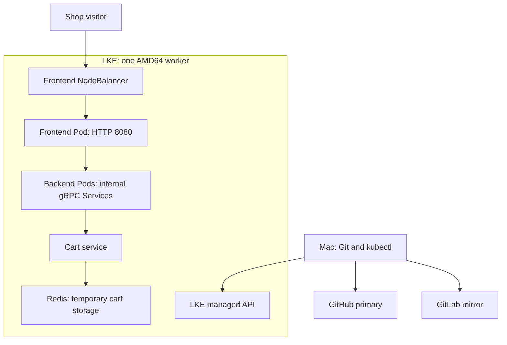

# RUNBOOK — Deploy Microservices in Kubernetes on Linode LKE

This standalone guide reproduces the implementation from a fresh workspace through local validation, cloud deployment, verification, troubleshooting, recovery, release and cleanup. All required manifest contents are included in section 5. No conversation history is needed.

Run small command blocks individually. Text labelled as output or expected result is not a shell command. Commands target the Mac unless explicitly identified as Cloud Manager actions or commands inside a Pod. Use Vim or another editor to create files; no combined setup script is required.

## Contents

1. Scope, architecture and verification status
2. Prerequisites
3. Local repository, baseline and remote workflow
4. Application contract and implementation choices
5. Full configuration contents
6. Local Minikube validation and Redis testing
7. LKE provisioning and connection
8. Cloud deployment and application verification
9. Redis network isolation test and actual troubleshooting
10. Recovery and rollback
11. Cleanup
12. Documentation and final Git release
13. Troubleshooting reference

## 1. Scope, architecture and verification status

Deploy ten Google Online Boutique microservices plus Redis to LKE with plain Kubernetes manifests. The assignment requires Deployments and Services for the shop and deployment to Linode's managed Kubernetes cluster. Helm, Helmfile, CI/CD and application image rebuilding are outside this implementation's scope.




The backend group summarizes application dependencies. The tables below provide the exact Service ports and configured outbound connections. All application resources use namespace `online-boutique`.

| Component | Service port | Container port |
|---|---:|---:|
| `adservice` | 9555 | 9555 |
| `cartservice` | 7070 | 7070 |
| `checkoutservice` | 5050 | 5050 |
| `currencyservice` | 7000 | 7000 |
| `emailservice` | 5000 | 8080 |
| `frontend` | 80 | 8080 |
| `paymentservice` | 50051 | 50051 |
| `productcatalogservice` | 3550 | 3550 |
| `recommendationservice` | 8080 | 8080 |
| `redis-cart` | 6379 | 6379 |
| `shippingservice` | 50051 | 50051 |

`frontend-external` is an additional LoadBalancer Service on port 80 targeting frontend port 8080.

| Caller | Configured application destinations |
|---|---|
| Frontend | Catalogue `3550`, currency `7000`, cart `7070`, recommendation `8080`, shipping `50051`, checkout `5050`, ads `9555` |
| Checkout | Catalogue `3550`, shipping `50051`, payment `50051`, email `5000`, currency `7000`, cart `7070` |
| Recommendation | Catalogue `3550` |
| Cart | Redis `6379` |

These are Kubernetes Service ports, not necessarily container ports: email maps Service port 5000 to container port 8080.

| Check | Evidence and result |
|---|---|
| Manifest validation | Every manifest passed server-side dry-run validation on Minikube. |
| Image references | Registry inspection succeeded for all selected application tags and Redis. Frontend/cart were verified AMD64; Redis supports AMD64 and ARM64. |
| Local Redis | Ready Pod, Service endpoint, PONG inside Redis and from a separate client Pod. |
| Local Redis security | UID/GID 1000; root filesystem write rejected; `/data` write succeeded and test file removed. |
| LKE worker | One AMD64 worker was Ready. API server v1.36.5; worker Kubernetes v1.36.3; client v1.37.0. |
| Application runtime | Eleven Deployments were available with one ready Pod each and zero restarts at the initial inspection. |
| Frontend exposure | LoadBalancer Service received an external IP. |
| Simulated checkout | Checkout logs recorded PlaceOrder, simulated payment success, and simulated email confirmation. |
| Redis isolation | Unlabelled client could not connect to `redis-cart:6379`; logs reported Operation timed out, exit code 1. This supports blocked ingress. |
| Frontend recovery | Rollout restart completed successfully. This tests controlled restart, not node-failure recovery or rollback. |
| Cleanup | Owner confirmed deletion of LKE, worker and NodeBalancer in Cloud Manager; local Minikube profile was stopped. |
| Later inventory | EndpointSlice/PVC/final inventory requests failed after cloud deletion; they were not verified by those requests. |

Browser confirmation of currency switching, the final order page, and cart retention after the frontend restart was requested but not separately confirmed in the recorded outputs. Do not claim those specific checks passed solely from Pod readiness.

- This is a working educational deployment with selected production and security practices, not a fully production-ready shop.
- One worker and one replica per component provide no worker-node redundancy.
- Redis has no replication or durable persistence. `emptyDir` is lost with Pod replacement; persistence is disabled and `allkeys-lru` may evict cart keys.
- HTTP exposure has no TLS in this implementation. Payment and email operations are simulated.
- Only Redis ingress is restricted by NetworkPolicy; other application Pods are not isolated by a default-deny policy. Label permissions matter because the rule allows `app=cartservice`.
- Workloads omit service-account tokens, but custom operator RBAC and control-plane ACL configuration were not implemented or verified.
- Application images use version tags, not immutable digests. Redis is digest pinned. Availability was checked; no image vulnerability scan was performed.
- The Redis test's timeout wrapper did not enforce the intended five-second bound. Its observed connection failure, not the wrapper duration, is the recorded evidence.

## 2. Prerequisites

### Accounts and permissions

- GitHub and GitLab access with permission to create and push repositories.
- SSH authentication already configured for both providers. Authentication was demonstrated by successful pushes; no keys or tokens belong in this repository.
- Linode/Akamai account with billing and permission to create/delete LKE and NodeBalancers.
- A network connection that can reach GitLab, GitHub, Docker Hub, Google Container Registry and the LKE API.

### Tested workstation

| Component | Recorded value |
|---|---|
| Mac | ARM64; 16 GiB RAM |
| Git | 2.52.0 |
| Docker Desktop | 4.77.0; engine 29.5.3 |
| Docker allocation | 10 CPUs; approximately 7.75 GiB RAM |
| Host kubectl | v1.37.0 |
| Minikube | v1.38.1 |
| Local Kubernetes | v1.35.1, containerd 2.2.1 |
| LKE API / worker | v1.36.5 / v1.36.3 |

Equivalent supported tool versions may be used. Choose a kubectl compatible with the selected cloud Kubernetes version. For Minikube use its matched kubectl wrapper, because the recorded host client was two minor versions ahead of the local server.

If tools are missing, install Git, Docker Desktop, kubectl and Minikube using their official installers before continuing. Installation commands were not executed in this project; working installations already existed. References: [Git](https://git-scm.com/downloads), [Docker Desktop](https://docs.docker.com/desktop/setup/install/mac-install/), [kubectl](https://kubernetes.io/docs/tasks/tools/install-kubectl-macos/), [Minikube](https://minikube.sigs.k8s.io/docs/start/).

### Inspect the workstation

```bash
uname -m
sysctl -n hw.memsize
git --version
git config --get user.name
git config --get user.email
```

```bash
docker version
docker info --format 'Architecture={{.Architecture}} CPUs={{.NCPU}} MemoryBytes={{.MemTotal}}'
```

```bash
kubectl version --client
kubectl config get-contexts
minikube version
minikube profile list
```


The existing local profiles were stopped. Do not reuse another project's cluster or execute cloud commands against an unrelated context.

## 3. Local repository, baseline and remote workflow

### Option A — clone the completed portfolio configuration

Use this for redeployment; it is an alternative to constructing a new independent baseline. Until the final release is pushed, use `develop`. After release, use `main`.

```bash
mkdir -p ~/Documents/tech-workspace/devops-capstone-projects
cd ~/Documents/tech-workspace/devops-capstone-projects
git clone --branch develop git@github.com:younghadiz/deploy-microservices-kubernetes.git
cd deploy-microservices-kubernetes
git remote add gitlab git@gitlab.com:devops-engineering-projects/deploy-microservices-kubernetes.git
```


Do not clone into an existing project directory. For an existing checkout, switch to the intended branch and pull with `--ff-only`. Then proceed to section 6; its file contents already match section 5.

### Option B — build a new independent portfolio repository

This reconstructs the original implementation flow. Use your own GitHub/GitLab names for a new repository. The shown original remote URLs already contain history and must not be treated as empty repositories.

Create an empty directory and initialize Git. Inspect an existing directory before reusing it.

```bash
mkdir -p ~/Documents/tech-workspace/devops-capstone-projects
cd ~/Documents/tech-workspace/devops-capstone-projects
mkdir deploy-microservices-kubernetes
cd deploy-microservices-kubernetes
git init -b main
```


Verify the upstream branch, then clone outside the independent repository:

```bash
git ls-remote --heads https://gitlab.com/twn-devops-bootcamp/latest/10-kubernetes/helm-chart-microservices.git
```

```bash
nana_source_dir=$(mktemp -d /tmp/nana-microservices.XXXXXX)
```

```bash
git clone --depth 1 --branch starting-code https://gitlab.com/twn-devops-bootcamp/latest/10-kubernetes/helm-chart-microservices.git "$nana_source_dir"
```

```bash
git -C "$nana_source_dir" rev-parse HEAD
git -C "$nana_source_dir" ls-tree -r --name-only HEAD
git -C "$nana_source_dir" show HEAD:config.yaml
```


Expected starting commit: `0b4131e5ac315050b01b5f69ed9d3053adb2642b`. If the branch differs, stop and review before importing. To inspect the original pinned commit using a full source clone, fetch the repository history and check out that commit in the temporary source directory; do not silently substitute newer files. That fallback was not needed in the recorded implementation.

Only `config.yaml` is relevant to this plain-manifest baseline. Keep the independent `.git` metadata; the upstream metadata stays in the temporary clone and is never imported.

```bash
cp "$nana_source_dir/config.yaml" ./config.yaml
diff "$nana_source_dir/config.yaml" ./config.yaml
```


No diff output means the imported file matches. Create `.gitignore` and the initial README using the complete baseline contents in section 5. Attribute the original application and training sources.

```bash
git add config.yaml .gitignore README.md
git diff --cached --check
git diff --cached
```

```bash
git commit -m "chore: import Kubernetes starting baseline"
git switch -c develop
```


The original independent baseline is `167d94a12e2a8a4a8f876ec9f570f282d57a5006`. A reconstruction will generate a different commit SHA because author/timestamp and any file differences affect the hash.

### Create empty remotes

Create GitHub primary and GitLab secondary repositories without README/licence/gitignore initialization. Original names: `younghadiz/deploy-microservices-kubernetes` and `devops-engineering-projects/deploy-microservices-kubernetes`.

Description:

> Deploy Google's Online Boutique microservices on Linode LKE using Kubernetes Deployments and Services, with production and security best practices, deployment verification, and a complete reproducible runbook.

For the original repository setup, the commands were:

```bash
git remote add origin git@github.com:younghadiz/deploy-microservices-kubernetes.git
git remote add gitlab git@gitlab.com:devops-engineering-projects/deploy-microservices-kubernetes.git
git remote -v
```

```bash
git ls-remote --heads origin
git ls-remote --heads gitlab
```


Empty remotes return no branch refs. If branches already exist, review their history; do not force-push to replace it.

```bash
git push -u origin main
git push -u origin develop
```

```bash
git push gitlab main
git push gitlab develop
```

```bash
git ls-remote --heads origin main develop
git ls-remote --heads gitlab main develop
```


GitHub remains the tracking remote. Push explicitly to GitLab without changing tracking.

### Feature implementation

```bash
git switch develop
git pull --ff-only origin develop
git switch -c feature/kubernetes-manifests
```


Write the complete files from section 5, understanding the ports/dependencies described in section 4. The recorded implementation introduced Redis first, tested it locally, then added catalogue, cart, currency, shipping, payment, email, recommendation, ads, checkout and frontend. Validate each logical addition or the completed collection before committing.

```bash
git add k8s/
git diff --cached --check
git diff --cached --stat
git commit -m "feat: add Online Boutique Kubernetes deployment manifests"
```

```bash
git push -u origin feature/kubernetes-manifests
git push gitlab feature/kubernetes-manifests
```


Historically the NetworkPolicy was added in a second commit:

```bash
git add k8s/redis-networkpolicy.yaml
git commit -m "feat: restrict Redis ingress to cart service"
git push origin feature/kubernetes-manifests
git push gitlab feature/kubernetes-manifests
```


If all files including the policy were introduced in the first commit during reproduction, skip the second commit rather than create an empty one.

Integrate prepared work:

```bash
git switch develop
git pull --ff-only origin develop
git merge --no-ff feature/kubernetes-manifests -m "merge: integrate Kubernetes manifests and Redis network policy"
```

```bash
git push origin develop
git push gitlab develop
git status --short --branch
git log --graph --oneline --decorate -5
```


Recorded integration commit: `098217f`. Create the cloud-deployment branch from `develop`:

```bash
git switch -c feature/lke-deployment
```


## 4. Application contract and implementation choices

| Component | Service port | Container port |
|---|---:|---:|
| `adservice` | 9555 | 9555 |
| `cartservice` | 7070 | 7070 |
| `checkoutservice` | 5050 | 5050 |
| `currencyservice` | 7000 | 7000 |
| `emailservice` | 5000 | 8080 |
| `frontend` | 80 | 8080 |
| `paymentservice` | 50051 | 50051 |
| `productcatalogservice` | 3550 | 3550 |
| `recommendationservice` | 8080 | 8080 |
| `redis-cart` | 6379 | 6379 |
| `shippingservice` | 50051 | 50051 |

`frontend-external` is an additional LoadBalancer Service on port 80 targeting frontend port 8080.
| Caller | Configured application destinations |
|---|---|
| Frontend | Catalogue `3550`, currency `7000`, cart `7070`, recommendation `8080`, shipping `50051`, checkout `5050`, ads `9555` |
| Checkout | Catalogue `3550`, shipping `50051`, payment `50051`, email `5000`, currency `7000`, cart `7070` |
| Recommendation | Catalogue `3550` |
| Cart | Redis `6379` |

These are Kubernetes Service ports, not necessarily container ports: email maps Service port 5000 to container port 8080.

### Why these settings exist

- Deployment selectors exactly match Pod labels; Services use those same labels.
- `PORT` configures an application's listener; `containerPort` merely declares the port. Cart uses its application's default 7070 and `REDIS_ADDR`.
- Values use Service DNS names in the same namespace.
- gRPC probes use numerical container ports. Frontend HTTP probes use `/_healthz` and a fixed session cookie.
- Startup probes delay readiness/liveness checks until startup succeeds; probes are not end-to-end checkout tests.
- CPU/memory requests reserve scheduling capacity; limits cap usage. The sum of this configuration's requests is 1300m CPU and 1040Mi memory, excluding Kubernetes overhead and temporary rollout surge.
- One replica per component supports this low-cost demonstration, not high availability. Redis uses Recreate to avoid overlapping independent Redis instances during updates.
- UID/GID 1000, dropped capabilities, RuntimeDefault seccomp and read-only root filesystems are independently selected hardening settings. Redis uses `fsGroup` and an `emptyDir` mount to make `/data` writable.
- Redis's dataset is capped at 128 MB with `allkeys-lru`; container memory is capped separately at 256Mi. Eviction can discard carts, and allocator/process overhead exists beyond dataset memory.
- Redis is unauthenticated in this demo; NetworkPolicy is a network boundary, not a substitute for authentication in a production design.
- Redis's multi-platform digest selects ARM64 locally and AMD64 on LKE.
- Nana's completed manifest uses two replicas for most components and `redis:alpine`. Two independent Redis Pods behind one Service do not constitute configured Redis replication. We intentionally use one instance and a pinned Redis version/digest.
- Internal frontend and external frontend Services share a selector; only the external file provisions cloud load-balancing.

## 5. Full configuration contents

Create the directories:

```bash
mkdir -p k8s/lke
```


Open each listed file with `vim <path>`, paste its entire block, save and exit. These are exact contents read from the committed configuration at `098217f`, not abbreviated examples. Keep the root starting skeleton as provenance; never apply it to Kubernetes.


### `.gitignore`

```gitignore
# macOS
.DS_Store

# Local environment files
.env
.env.*
!.env.example

# Kubernetes credentials
.kube/
kubeconfig
kubeconfig.*
*-kubeconfig*
*.kubeconfig

# Private keys
*.pem
*.key

# Local tooling environments
.venv/
__pycache__/

# Temporary files
*.log
*.tmp
*.swp
*~
```


### `config.yaml`

```yaml
---
apiVersion: apps/v1
kind: Deployment
metadata:
  name: xxxx
spec:
  selector:
    matchLabels:
      app: xxxx
  template:
    metadata:
      labels:
        app: xxxx
    spec:
      containers:
      - name: xxxx
        image: xxxx
        ports:
        - containerPort: xxxx

---
apiVersion: v1
kind: Service
metadata:
  name: xxxx
spec:
  type: ClusterIP
  selector:
    app: xxxx
  ports:
  - protocol: TCP
    port: xxxx
    targetPort: xxxx
```


### Initial baseline `README.md`

Use this during a fresh baseline import; replace it with the final README during documentation.

```markdown
# Deploy Microservices in Kubernetes

## Project objective

Deploy Google's Online Boutique microservices application to Linode LKE
using Kubernetes Deployments and Services, then implement and verify
production and security practices.

Status: repository preparation. Deployment has not yet been performed.

## Source provenance

- Training provider: TechWorld with Nana.
- Upstream repository:
  https://gitlab.com/twn-devops-bootcamp/latest/10-kubernetes/helm-chart-microservices
- Starting branch: `starting-code`.
- Baseline commit: `0b4131e5ac315050b01b5f69ed9d3053adb2642b`.
- Imported file: `config.yaml`, unchanged from the pinned starting source.

The imported file is an unfinished Kubernetes Deployment and Service
skeleton. It does not contain the Online Boutique application source.

The upstream Helm charts, Helmfile, values and installation scripts were
not imported because the current assignment focuses on Kubernetes manifests.

## Attribution

- Google Cloud: original Online Boutique application.
- TechWorld with Nana: training material and starting configuration skeleton.
- Gafari Salaudeen: independent Kubernetes configuration, deployment,
  validation, troubleshooting and documentation developed during this project.

## Git workflow

GitHub is the primary remote (`origin`).
GitLab is the secondary remote (`gitlab`).

Implementation follows:

`feature/<task>` → validated merge into `develop` → final release into `main`.

Feature and release merges use `--no-ff`.

## Documentation

This README and `docs/RUNBOOK.md` will be finalized after implementation
and deployment verification.

The final runbook will contain the complete reproduction procedure,
configuration contents, Git workflow, verification, troubleshooting,
rollback and cleanup.
```


### `k8s/adservice.yaml`

```yaml
apiVersion: apps/v1
kind: Deployment
metadata:
  name: adservice
  namespace: online-boutique
  labels:
    app: adservice
    app.kubernetes.io/part-of: online-boutique
spec:
  replicas: 1
  selector:
    matchLabels:
      app: adservice
  template:
    metadata:
      labels:
        app: adservice
        app.kubernetes.io/part-of: online-boutique
    spec:
      automountServiceAccountToken: false
      securityContext:
        runAsNonRoot: true
        runAsUser: 1000
        runAsGroup: 1000
        seccompProfile:
          type: RuntimeDefault
      containers:
        - name: adservice
          image: gcr.io/google-samples/microservices-demo/adservice:v0.8.0
          ports:
            - name: grpc
              containerPort: 9555
          env:
            - name: PORT
              value: "9555"
          securityContext:
            allowPrivilegeEscalation: false
            readOnlyRootFilesystem: true
            capabilities:
              drop:
                - ALL
          resources:
            requests:
              cpu: 200m
              memory: 180Mi
            limits:
              cpu: 300m
              memory: 300Mi
          startupProbe:
            grpc:
              port: 9555
            periodSeconds: 5
            failureThreshold: 30
          readinessProbe:
            grpc:
              port: 9555
            periodSeconds: 15
          livenessProbe:
            grpc:
              port: 9555
            periodSeconds: 15
---
apiVersion: v1
kind: Service
metadata:
  name: adservice
  namespace: online-boutique
  labels:
    app: adservice
    app.kubernetes.io/part-of: online-boutique
spec:
  type: ClusterIP
  selector:
    app: adservice
  ports:
    - name: grpc
      port: 9555
      targetPort: grpc
```


### `k8s/cartservice.yaml`

```yaml
apiVersion: apps/v1
kind: Deployment
metadata:
  name: cartservice
  namespace: online-boutique
  labels:
    app: cartservice
    app.kubernetes.io/part-of: online-boutique
spec:
  replicas: 1
  selector:
    matchLabels:
      app: cartservice
  template:
    metadata:
      labels:
        app: cartservice
        app.kubernetes.io/part-of: online-boutique
    spec:
      automountServiceAccountToken: false
      securityContext:
        runAsNonRoot: true
        runAsUser: 1000
        runAsGroup: 1000
        seccompProfile:
          type: RuntimeDefault
      containers:
        - name: cartservice
          image: gcr.io/google-samples/microservices-demo/cartservice:v0.8.0
          ports:
            - name: grpc
              containerPort: 7070
          env:
            - name: REDIS_ADDR
              value: "redis-cart:6379"
          securityContext:
            allowPrivilegeEscalation: false
            readOnlyRootFilesystem: true
            capabilities:
              drop:
                - ALL
          resources:
            requests:
              cpu: 200m
              memory: 64Mi
            limits:
              cpu: 300m
              memory: 128Mi
          startupProbe:
            grpc:
              port: 7070
            periodSeconds: 5
            failureThreshold: 30
          readinessProbe:
            grpc:
              port: 7070
            periodSeconds: 5
          livenessProbe:
            grpc:
              port: 7070
            periodSeconds: 10
---
apiVersion: v1
kind: Service
metadata:
  name: cartservice
  namespace: online-boutique
  labels:
    app: cartservice
    app.kubernetes.io/part-of: online-boutique
spec:
  type: ClusterIP
  selector:
    app: cartservice
  ports:
    - name: grpc
      port: 7070
      targetPort: grpc
```


### `k8s/checkoutservice.yaml`

```yaml
apiVersion: apps/v1
kind: Deployment
metadata:
  name: checkoutservice
  namespace: online-boutique
  labels:
    app: checkoutservice
    app.kubernetes.io/part-of: online-boutique
spec:
  replicas: 1
  selector:
    matchLabels:
      app: checkoutservice
  template:
    metadata:
      labels:
        app: checkoutservice
        app.kubernetes.io/part-of: online-boutique
    spec:
      automountServiceAccountToken: false
      securityContext:
        runAsNonRoot: true
        runAsUser: 1000
        runAsGroup: 1000
        seccompProfile:
          type: RuntimeDefault
      containers:
        - name: checkoutservice
          image: gcr.io/google-samples/microservices-demo/checkoutservice:v0.8.0
          ports:
            - name: grpc
              containerPort: 5050
          env:
            - name: PORT
              value: "5050"
            - name: PRODUCT_CATALOG_SERVICE_ADDR
              value: "productcatalogservice:3550"
            - name: SHIPPING_SERVICE_ADDR
              value: "shippingservice:50051"
            - name: PAYMENT_SERVICE_ADDR
              value: "paymentservice:50051"
            - name: EMAIL_SERVICE_ADDR
              value: "emailservice:5000"
            - name: CURRENCY_SERVICE_ADDR
              value: "currencyservice:7000"
            - name: CART_SERVICE_ADDR
              value: "cartservice:7070"
          securityContext:
            allowPrivilegeEscalation: false
            readOnlyRootFilesystem: true
            capabilities:
              drop:
                - ALL
          resources:
            requests:
              cpu: 100m
              memory: 64Mi
            limits:
              cpu: 200m
              memory: 128Mi
          startupProbe:
            grpc:
              port: 5050
            periodSeconds: 2
            failureThreshold: 30
          readinessProbe:
            grpc:
              port: 5050
            periodSeconds: 5
          livenessProbe:
            grpc:
              port: 5050
            periodSeconds: 10
---
apiVersion: v1
kind: Service
metadata:
  name: checkoutservice
  namespace: online-boutique
  labels:
    app: checkoutservice
    app.kubernetes.io/part-of: online-boutique
spec:
  type: ClusterIP
  selector:
    app: checkoutservice
  ports:
    - name: grpc
      port: 5050
      targetPort: grpc
```


### `k8s/currencyservice.yaml`

```yaml
apiVersion: apps/v1
kind: Deployment
metadata:
  name: currencyservice
  namespace: online-boutique
  labels:
    app: currencyservice
    app.kubernetes.io/part-of: online-boutique
spec:
  replicas: 1
  selector:
    matchLabels:
      app: currencyservice
  template:
    metadata:
      labels:
        app: currencyservice
        app.kubernetes.io/part-of: online-boutique
    spec:
      automountServiceAccountToken: false
      securityContext:
        runAsNonRoot: true
        runAsUser: 1000
        runAsGroup: 1000
        seccompProfile:
          type: RuntimeDefault
      containers:
        - name: currencyservice
          image: gcr.io/google-samples/microservices-demo/currencyservice:v0.8.0
          ports:
            - name: grpc
              containerPort: 7000
          env:
            - name: PORT
              value: "7000"
            - name: DISABLE_PROFILER
              value: "1"
          securityContext:
            allowPrivilegeEscalation: false
            readOnlyRootFilesystem: true
            capabilities:
              drop:
                - ALL
          resources:
            requests:
              cpu: 100m
              memory: 64Mi
            limits:
              cpu: 200m
              memory: 128Mi
          startupProbe:
            grpc:
              port: 7000
            periodSeconds: 2
            failureThreshold: 30
          readinessProbe:
            grpc:
              port: 7000
            periodSeconds: 5
          livenessProbe:
            grpc:
              port: 7000
            periodSeconds: 10
---
apiVersion: v1
kind: Service
metadata:
  name: currencyservice
  namespace: online-boutique
  labels:
    app: currencyservice
    app.kubernetes.io/part-of: online-boutique
spec:
  type: ClusterIP
  selector:
    app: currencyservice
  ports:
    - name: grpc
      port: 7000
      targetPort: grpc
```


### `k8s/emailservice.yaml`

```yaml
apiVersion: apps/v1
kind: Deployment
metadata:
  name: emailservice
  namespace: online-boutique
  labels:
    app: emailservice
    app.kubernetes.io/part-of: online-boutique
spec:
  replicas: 1
  selector:
    matchLabels:
      app: emailservice
  template:
    metadata:
      labels:
        app: emailservice
        app.kubernetes.io/part-of: online-boutique
    spec:
      automountServiceAccountToken: false
      securityContext:
        runAsNonRoot: true
        runAsUser: 1000
        runAsGroup: 1000
        seccompProfile:
          type: RuntimeDefault
      containers:
        - name: emailservice
          image: gcr.io/google-samples/microservices-demo/emailservice:v0.8.0
          ports:
            - name: grpc
              containerPort: 8080
          env:
            - name: PORT
              value: "8080"
            - name: DISABLE_PROFILER
              value: "1"
          securityContext:
            allowPrivilegeEscalation: false
            readOnlyRootFilesystem: true
            capabilities:
              drop:
                - ALL
          resources:
            requests:
              cpu: 100m
              memory: 64Mi
            limits:
              cpu: 200m
              memory: 128Mi
          startupProbe:
            grpc:
              port: 8080
            periodSeconds: 2
            failureThreshold: 30
          readinessProbe:
            grpc:
              port: 8080
            periodSeconds: 5
          livenessProbe:
            grpc:
              port: 8080
            periodSeconds: 10
---
apiVersion: v1
kind: Service
metadata:
  name: emailservice
  namespace: online-boutique
  labels:
    app: emailservice
    app.kubernetes.io/part-of: online-boutique
spec:
  type: ClusterIP
  selector:
    app: emailservice
  ports:
    - name: grpc
      port: 5000
      targetPort: grpc
```


### `k8s/frontend.yaml`

```yaml
apiVersion: apps/v1
kind: Deployment
metadata:
  name: frontend
  namespace: online-boutique
  labels:
    app: frontend
    app.kubernetes.io/part-of: online-boutique
spec:
  replicas: 1
  selector:
    matchLabels:
      app: frontend
  template:
    metadata:
      labels:
        app: frontend
        app.kubernetes.io/part-of: online-boutique
    spec:
      automountServiceAccountToken: false
      securityContext:
        runAsNonRoot: true
        runAsUser: 1000
        runAsGroup: 1000
        seccompProfile:
          type: RuntimeDefault
      containers:
        - name: frontend
          image: gcr.io/google-samples/microservices-demo/frontend:v0.8.0
          ports:
            - name: http
              containerPort: 8080
          env:
            - name: PORT
              value: "8080"
            - name: PRODUCT_CATALOG_SERVICE_ADDR
              value: "productcatalogservice:3550"
            - name: CURRENCY_SERVICE_ADDR
              value: "currencyservice:7000"
            - name: CART_SERVICE_ADDR
              value: "cartservice:7070"
            - name: RECOMMENDATION_SERVICE_ADDR
              value: "recommendationservice:8080"
            - name: SHIPPING_SERVICE_ADDR
              value: "shippingservice:50051"
            - name: CHECKOUT_SERVICE_ADDR
              value: "checkoutservice:5050"
            - name: AD_SERVICE_ADDR
              value: "adservice:9555"
            - name: ENABLE_PROFILER
              value: "0"
          securityContext:
            allowPrivilegeEscalation: false
            readOnlyRootFilesystem: true
            capabilities:
              drop:
                - ALL
          resources:
            requests:
              cpu: 100m
              memory: 64Mi
            limits:
              cpu: 200m
              memory: 128Mi
          startupProbe:
            httpGet:
              path: /_healthz
              port: http
              httpHeaders:
                - name: Cookie
                  value: shop_session-id=startup-probe
            periodSeconds: 2
            failureThreshold: 30
          readinessProbe:
            httpGet:
              path: /_healthz
              port: http
              httpHeaders:
                - name: Cookie
                  value: shop_session-id=readiness-probe
            periodSeconds: 5
          livenessProbe:
            httpGet:
              path: /_healthz
              port: http
              httpHeaders:
                - name: Cookie
                  value: shop_session-id=liveness-probe
            periodSeconds: 10
---
apiVersion: v1
kind: Service
metadata:
  name: frontend
  namespace: online-boutique
  labels:
    app: frontend
    app.kubernetes.io/part-of: online-boutique
spec:
  type: ClusterIP
  selector:
    app: frontend
  ports:
    - name: http
      port: 80
      targetPort: http
```


### `k8s/lke/frontend-external.yaml`

```yaml
apiVersion: v1
kind: Service
metadata:
  name: frontend-external
  namespace: online-boutique
  labels:
    app: frontend
    app.kubernetes.io/part-of: online-boutique
spec:
  type: LoadBalancer
  selector:
    app: frontend
  ports:
    - name: http
      port: 80
      targetPort: http
```


### `k8s/namespace.yaml`

```yaml
apiVersion: v1
kind: Namespace
metadata:
  name: online-boutique
  labels:
    app.kubernetes.io/part-of: online-boutique
```


### `k8s/paymentservice.yaml`

```yaml
apiVersion: apps/v1
kind: Deployment
metadata:
  name: paymentservice
  namespace: online-boutique
  labels:
    app: paymentservice
    app.kubernetes.io/part-of: online-boutique
spec:
  replicas: 1
  selector:
    matchLabels:
      app: paymentservice
  template:
    metadata:
      labels:
        app: paymentservice
        app.kubernetes.io/part-of: online-boutique
    spec:
      automountServiceAccountToken: false
      securityContext:
        runAsNonRoot: true
        runAsUser: 1000
        runAsGroup: 1000
        seccompProfile:
          type: RuntimeDefault
      containers:
        - name: paymentservice
          image: gcr.io/google-samples/microservices-demo/paymentservice:v0.8.0
          ports:
            - name: grpc
              containerPort: 50051
          env:
            - name: PORT
              value: "50051"
            - name: DISABLE_PROFILER
              value: "1"
          securityContext:
            allowPrivilegeEscalation: false
            readOnlyRootFilesystem: true
            capabilities:
              drop:
                - ALL
          resources:
            requests:
              cpu: 100m
              memory: 64Mi
            limits:
              cpu: 200m
              memory: 128Mi
          startupProbe:
            grpc:
              port: 50051
            periodSeconds: 2
            failureThreshold: 30
          readinessProbe:
            grpc:
              port: 50051
            periodSeconds: 5
          livenessProbe:
            grpc:
              port: 50051
            periodSeconds: 10
---
apiVersion: v1
kind: Service
metadata:
  name: paymentservice
  namespace: online-boutique
  labels:
    app: paymentservice
    app.kubernetes.io/part-of: online-boutique
spec:
  type: ClusterIP
  selector:
    app: paymentservice
  ports:
    - name: grpc
      port: 50051
      targetPort: grpc
```


### `k8s/productcatalogservice.yaml`

```yaml
apiVersion: apps/v1
kind: Deployment
metadata:
  name: productcatalogservice
  namespace: online-boutique
  labels:
    app: productcatalogservice
    app.kubernetes.io/part-of: online-boutique
spec:
  replicas: 1
  selector:
    matchLabels:
      app: productcatalogservice
  template:
    metadata:
      labels:
        app: productcatalogservice
        app.kubernetes.io/part-of: online-boutique
    spec:
      automountServiceAccountToken: false
      securityContext:
        runAsNonRoot: true
        runAsUser: 1000
        runAsGroup: 1000
        seccompProfile:
          type: RuntimeDefault
      containers:
        - name: productcatalogservice
          image: gcr.io/google-samples/microservices-demo/productcatalogservice:v0.8.0
          ports:
            - name: grpc
              containerPort: 3550
          env:
            - name: PORT
              value: "3550"
            - name: DISABLE_PROFILER
              value: "1"
          securityContext:
            allowPrivilegeEscalation: false
            readOnlyRootFilesystem: true
            capabilities:
              drop:
                - ALL
          resources:
            requests:
              cpu: 100m
              memory: 64Mi
            limits:
              cpu: 200m
              memory: 128Mi
          startupProbe:
            grpc:
              port: 3550
            periodSeconds: 2
            failureThreshold: 30
          readinessProbe:
            grpc:
              port: 3550
            periodSeconds: 5
          livenessProbe:
            grpc:
              port: 3550
            periodSeconds: 10
---
apiVersion: v1
kind: Service
metadata:
  name: productcatalogservice
  namespace: online-boutique
  labels:
    app: productcatalogservice
    app.kubernetes.io/part-of: online-boutique
spec:
  type: ClusterIP
  selector:
    app: productcatalogservice
  ports:
    - name: grpc
      port: 3550
      targetPort: grpc
```


### `k8s/recommendationservice.yaml`

```yaml
apiVersion: apps/v1
kind: Deployment
metadata:
  name: recommendationservice
  namespace: online-boutique
  labels:
    app: recommendationservice
    app.kubernetes.io/part-of: online-boutique
spec:
  replicas: 1
  selector:
    matchLabels:
      app: recommendationservice
  template:
    metadata:
      labels:
        app: recommendationservice
        app.kubernetes.io/part-of: online-boutique
    spec:
      automountServiceAccountToken: false
      securityContext:
        runAsNonRoot: true
        runAsUser: 1000
        runAsGroup: 1000
        seccompProfile:
          type: RuntimeDefault
      containers:
        - name: recommendationservice
          image: gcr.io/google-samples/microservices-demo/recommendationservice:v0.8.0
          ports:
            - name: grpc
              containerPort: 8080
          env:
            - name: PORT
              value: "8080"
            - name: PRODUCT_CATALOG_SERVICE_ADDR
              value: "productcatalogservice:3550"
            - name: DISABLE_PROFILER
              value: "1"
          securityContext:
            allowPrivilegeEscalation: false
            readOnlyRootFilesystem: true
            capabilities:
              drop:
                - ALL
          resources:
            requests:
              cpu: 100m
              memory: 220Mi
            limits:
              cpu: 200m
              memory: 450Mi
          startupProbe:
            grpc:
              port: 8080
            periodSeconds: 5
            failureThreshold: 30
          readinessProbe:
            grpc:
              port: 8080
            periodSeconds: 5
          livenessProbe:
            grpc:
              port: 8080
            periodSeconds: 10
---
apiVersion: v1
kind: Service
metadata:
  name: recommendationservice
  namespace: online-boutique
  labels:
    app: recommendationservice
    app.kubernetes.io/part-of: online-boutique
spec:
  type: ClusterIP
  selector:
    app: recommendationservice
  ports:
    - name: grpc
      port: 8080
      targetPort: grpc
```


### `k8s/redis-networkpolicy.yaml`

```yaml
apiVersion: networking.k8s.io/v1
kind: NetworkPolicy
metadata:
  name: redis-allow-cart
  namespace: online-boutique
spec:
  podSelector:
    matchLabels:
      app: redis-cart
  policyTypes:
    - Ingress
  ingress:
    - from:
        - podSelector:
            matchLabels:
              app: cartservice
      ports:
        - protocol: TCP
          port: 6379
```


### `k8s/redis.yaml`

```yaml
apiVersion: apps/v1
kind: Deployment
metadata:
  name: redis-cart
  namespace: online-boutique
  labels:
    app: redis-cart
    app.kubernetes.io/part-of: online-boutique
spec:
  replicas: 1
  strategy:
    type: Recreate
  selector:
    matchLabels:
      app: redis-cart
  template:
    metadata:
      labels:
        app: redis-cart
        app.kubernetes.io/part-of: online-boutique
    spec:
      automountServiceAccountToken: false
      securityContext:
        runAsNonRoot: true
        runAsUser: 1000
        runAsGroup: 1000
        fsGroup: 1000
        seccompProfile:
          type: RuntimeDefault
      containers:
        - name: redis
          image: redis:7.4.2-alpine@sha256:02419de7eddf55aa5bcf49efb74e88fa8d931b4d77c07eff8a6b2144472b6952
          imagePullPolicy: IfNotPresent
          args:
            - redis-server
            - --save
            - ""
            - --appendonly
            - "no"
            - --maxmemory
            - 128mb
            - --maxmemory-policy
            - allkeys-lru
          ports:
            - name: redis
              containerPort: 6379
          securityContext:
            allowPrivilegeEscalation: false
            readOnlyRootFilesystem: true
            capabilities:
              drop:
                - ALL
          resources:
            requests:
              cpu: 100m
              memory: 128Mi
            limits:
              cpu: 500m
              memory: 256Mi
          startupProbe:
            exec:
              command:
                - redis-cli
                - ping
            periodSeconds: 2
            timeoutSeconds: 2
            failureThreshold: 30
          readinessProbe:
            exec:
              command:
                - redis-cli
                - ping
            periodSeconds: 5
            timeoutSeconds: 2
          livenessProbe:
            exec:
              command:
                - redis-cli
                - ping
            periodSeconds: 10
            timeoutSeconds: 2
          volumeMounts:
            - name: redis-data
              mountPath: /data
      volumes:
        - name: redis-data
          emptyDir: {}
---
apiVersion: v1
kind: Service
metadata:
  name: redis-cart
  namespace: online-boutique
  labels:
    app: redis-cart
    app.kubernetes.io/part-of: online-boutique
spec:
  type: ClusterIP
  selector:
    app: redis-cart
  ports:
    - name: redis
      port: 6379
      targetPort: redis
```


### `k8s/shippingservice.yaml`

```yaml
apiVersion: apps/v1
kind: Deployment
metadata:
  name: shippingservice
  namespace: online-boutique
  labels:
    app: shippingservice
    app.kubernetes.io/part-of: online-boutique
spec:
  replicas: 1
  selector:
    matchLabels:
      app: shippingservice
  template:
    metadata:
      labels:
        app: shippingservice
        app.kubernetes.io/part-of: online-boutique
    spec:
      automountServiceAccountToken: false
      securityContext:
        runAsNonRoot: true
        runAsUser: 1000
        runAsGroup: 1000
        seccompProfile:
          type: RuntimeDefault
      containers:
        - name: shippingservice
          image: gcr.io/google-samples/microservices-demo/shippingservice:v0.8.0
          ports:
            - name: grpc
              containerPort: 50051
          env:
            - name: PORT
              value: "50051"
            - name: DISABLE_PROFILER
              value: "1"
          securityContext:
            allowPrivilegeEscalation: false
            readOnlyRootFilesystem: true
            capabilities:
              drop:
                - ALL
          resources:
            requests:
              cpu: 100m
              memory: 64Mi
            limits:
              cpu: 200m
              memory: 128Mi
          startupProbe:
            grpc:
              port: 50051
            periodSeconds: 2
            failureThreshold: 30
          readinessProbe:
            grpc:
              port: 50051
            periodSeconds: 5
          livenessProbe:
            grpc:
              port: 50051
            periodSeconds: 10
---
apiVersion: v1
kind: Service
metadata:
  name: shippingservice
  namespace: online-boutique
  labels:
    app: shippingservice
    app.kubernetes.io/part-of: online-boutique
spec:
  type: ClusterIP
  selector:
    app: shippingservice
  ports:
    - name: grpc
      port: 50051
      targetPort: grpc
```


## 6. Local Minikube validation and Redis testing

### Inspect image architecture before runtime testing

```bash
docker manifest inspect --verbose gcr.io/google-samples/microservices-demo/frontend:v0.8.0
docker manifest inspect --verbose gcr.io/google-samples/microservices-demo/cartservice:v0.8.0
```

```bash
docker buildx imagetools inspect redis:7.4.2-alpine
```


The inspected frontend/cart images were single-platform Linux AMD64. Redis's index includes AMD64 and ARM64. Full application runtime was tested on AMD64 LKE; local ARM testing was limited to Redis. Do not call server-side dry-run a local application deployment.

### Start a dedicated local profile

```bash
minikube start -p online-boutique-local --driver=docker --container-runtime=containerd --cpus=2 --memory=3072
```

```bash
minikube -p online-boutique-local kubectl -- get nodes -o wide
minikube -p online-boutique-local kubectl -- version
```


The recorded cluster and wrapper were both v1.35.1. This command uses the installed Minikube default; record the actual version in a new deployment rather than assuming it is unchanged.

### Validate namespace and deploy only Redis locally

```bash
minikube -p online-boutique-local kubectl -- apply --dry-run=server -f k8s/namespace.yaml
```

```bash
minikube -p online-boutique-local kubectl -- apply -f k8s/namespace.yaml
```

```bash
minikube -p online-boutique-local kubectl -- apply --dry-run=server -f k8s/redis.yaml
```

```bash
minikube -p online-boutique-local kubectl -- apply -f k8s/redis.yaml
```

```bash
minikube -p online-boutique-local kubectl -- rollout status deployment/redis-cart -n online-boutique --timeout=180s
```

```bash
minikube -p online-boutique-local kubectl -- get pods,services,endpointslices -n online-boutique
```

```bash
minikube -p online-boutique-local kubectl -- exec -n online-boutique deployment/redis-cart -- redis-cli ping
```

```bash
minikube -p online-boutique-local kubectl -- logs -n online-boutique deployment/redis-cart --tail=30
```


Expected: one ready Redis Pod, internal Service and endpoint, PONG, and Redis startup logs. The policy was not applied during this local cross-Pod test.

Test Service DNS from another Pod:

```bash
minikube -p online-boutique-local kubectl -- run redis-service-check -n online-boutique --image=redis:7.4.2-alpine@sha256:02419de7eddf55aa5bcf49efb74e88fa8d931b4d77c07eff8a6b2144472b6952 --restart=Never --rm -i --command -- redis-cli -h redis-cart -p 6379 ping
```


Expected: PONG and deletion of the client Pod. This establishes unrestricted baseline reachability locally; it does not test the later cloud policy.

### Verify Redis's user and filesystem

```bash
minikube -p online-boutique-local kubectl -- exec -n online-boutique deployment/redis-cart -- id
```


Expected UID/GID 1000.

```bash
minikube -p online-boutique-local kubectl -- exec -n online-boutique deployment/redis-cart -- touch /rootfs-write-check
```


Expected Read-only file system and exit code 1. This intentional failure is a passed security check.

```bash
minikube -p online-boutique-local kubectl -- exec -n online-boutique deployment/redis-cart -- touch /data/volume-write-check
```

```bash
minikube -p online-boutique-local kubectl -- exec -n online-boutique deployment/redis-cart -- rm /data/volume-write-check
```


Both `/data` commands should succeed without output.

### Validate application configuration locally

Each of these files was individually or jointly submitted with `--dry-run=server`; the compact grouped form below is equivalent API validation, not a new runtime claim:

```bash
minikube -p online-boutique-local kubectl -- apply --dry-run=server -f k8s/ -f k8s/lke/frontend-external.yaml
```


No containers or load balancer are created by dry-run. Do not execute ordinary `apply -f k8s/` on ARM expecting these AMD64 application images to run natively.

### Confirm remaining registry references

```bash
docker buildx imagetools inspect gcr.io/google-samples/microservices-demo/productcatalogservice:v0.8.0
docker buildx imagetools inspect gcr.io/google-samples/microservices-demo/recommendationservice:v0.8.0
docker buildx imagetools inspect gcr.io/google-samples/microservices-demo/adservice:v0.8.0
docker buildx imagetools inspect gcr.io/google-samples/microservices-demo/currencyservice:v0.8.0
docker buildx imagetools inspect gcr.io/google-samples/microservices-demo/shippingservice:v0.8.0
docker buildx imagetools inspect gcr.io/google-samples/microservices-demo/paymentservice:v0.8.0
docker buildx imagetools inspect gcr.io/google-samples/microservices-demo/emailservice:v0.8.0
docker buildx imagetools inspect gcr.io/google-samples/microservices-demo/checkoutservice:v0.8.0
```


All eight lookups succeeded in the original run. They establish registry availability, not vulnerability status or successful execution.

## 7. LKE provisioning and connection

Perform paid provisioning only after the configuration, local validation, Git checkpoint and cleanup procedure are ready.

### Cloud Manager setup

1. Open https://cloud.linode.com and choose Kubernetes, then Create Cluster.
2. Label the cluster `online-boutique-lke` and select standard LKE.
3. Choose an available nearby region; Toronto was recommended. The observed API endpoint used `ca-central-1`.
4. Select a supported Kubernetes version close to your kubectl. The actual API server reported v1.36.5 and worker v1.36.3.
5. Add one Shared CPU worker; 4 vCPUs/8 GB RAM was recommended for startup headroom. The exact selected plan was not separately recorded, so check the account summary before creating.
6. Keep paid HA and additional platform bundles disabled for this exercise; no autoscaling is required.
7. Review the actual account price and click Create Cluster. Billing begins when resources are provisioned.

At the original price check, the recommended worker cost US$0.072/hour and NodeBalancer US$0.015/hour; combined about US$0.087/hour while both exist. Recheck https://www.akamai.com/cloud/pricing. A single-node lab is not a production availability design.

### Kubeconfig

Download the cluster kubeconfig from Cloud Manager. The recorded filename was `online-boutique-lke-kubeconfig.yaml`; substitute the actual filename if different.

```bash
mkdir -p ~/.kube
```

```bash
mv ~/Downloads/online-boutique-lke-kubeconfig.yaml ~/.kube/online-boutique-lke.yaml
```

```bash
chmod 600 ~/.kube/online-boutique-lke.yaml
```

```bash
kubectl --kubeconfig="$HOME/.kube/online-boutique-lke.yaml" version
```

```bash
kubectl --kubeconfig="$HOME/.kube/online-boutique-lke.yaml" get nodes -o wide -L kubernetes.io/arch
```


Expected: Ready worker, architecture amd64, compatible client/server. Keep credentials outside Git and never paste kubeconfig contents into documentation. Explicit `--kubeconfig` prevents accidental use of another cluster.

## 8. Cloud deployment and application verification

### Create namespace, then components

```bash
kubectl --kubeconfig="$HOME/.kube/online-boutique-lke.yaml" apply -f k8s/namespace.yaml
```

```bash
kubectl --kubeconfig="$HOME/.kube/online-boutique-lke.yaml" apply -f k8s/
```


This non-recursive folder apply excludes `k8s/lke/`. The namespace is created first to avoid namespaced-resource failures. Root `config.yaml` is not a deployable file; it still contains xxxx placeholders.

```bash
kubectl --kubeconfig="$HOME/.kube/online-boutique-lke.yaml" wait --for=condition=Ready pod --all -n online-boutique --timeout=300s
```

```bash
kubectl --kubeconfig="$HOME/.kube/online-boutique-lke.yaml" get deployments,pods,services -n online-boutique
```


Expected eleven available Deployments and ready Pods. Original output showed all 1/1 and zero restarts. If a Pod is unhealthy, inspect it using section 13 before creating public access.

### Create external frontend Service

```bash
kubectl --kubeconfig="$HOME/.kube/online-boutique-lke.yaml" apply -f k8s/lke/frontend-external.yaml
```

```bash
kubectl --kubeconfig="$HOME/.kube/online-boutique-lke.yaml" get service frontend-external -n online-boutique --watch
```


This requests a billable NodeBalancer. Once EXTERNAL-IP appears, press Control+C to stop the watch. Open `http://<EXTERNAL-IP>` in a browser. The original external IP was 192.53.121.214; it is historical, released and must not be reused as the expected address in a new deployment.

### Application checks

Browse product details, switch currency, add a product, edit cart quantity, complete checkout with dummy values, and inspect the confirmation page. Refresh the cart after frontend restart. Record which browser behaviours you actually see; the recorded checkout logs prove the simulated backend path, but not every browser interaction.

```bash
kubectl --kubeconfig="$HOME/.kube/online-boutique-lke.yaml" logs -n online-boutique deployment/checkoutservice --tail=40
```


Observed log messages included PlaceOrder, payment went through, and order confirmation email sent. They refer to simulated operations; no real payment processing or email delivery is established.

### Resource inventory — run before cleanup

```bash
kubectl --kubeconfig="$HOME/.kube/online-boutique-lke.yaml" get deployments,pods,services -n online-boutique
```

```bash
kubectl --kubeconfig="$HOME/.kube/online-boutique-lke.yaml" get endpointslices -n online-boutique
```

```bash
kubectl --kubeconfig="$HOME/.kube/online-boutique-lke.yaml" describe networkpolicy redis-allow-cart -n online-boutique
```

```bash
kubectl --kubeconfig="$HOME/.kube/online-boutique-lke.yaml" get pvc -n online-boutique
```


Expect eleven Deployments and twelve Services after external exposure. Each Service should have appropriate ready endpoints; the two frontend Services share frontend Pods. No PVC is defined by these manifests. Check Cloud Manager for one project worker and one NodeBalancer.

Verification boundary: the initial live Deployment/Pod/internal-Service output was captured. The later EndpointSlice and PVC checks were attempted after cluster deletion and failed DNS resolution. Their expected results above are a reproduction checklist, not a claim that the original late checks passed.

## 9. Redis network isolation test and actual troubleshooting

The policy selects Redis Pods and allows ingress from app=cartservice Pods in the same namespace on TCP 6379. It does not restrict Redis egress. Policy enforcement depends on the cluster network plugin. A denied test without a healthy permitted path is inconclusive; verify actual cart access as well.

### Recorded denied client test

The first interactive `timeout 5 redis-cli ...` test did not complete at the intended five-second bound. Control+C stopped the local attachment but left a Pod; a repeated run returned AlreadyExists. It was deleted before retrying.

The retry was launched non-interactively:

```bash
kubectl --kubeconfig="$HOME/.kube/online-boutique-lke.yaml" run redis-blocked-check -n online-boutique --image=redis:7.4.2-alpine@sha256:02419de7eddf55aa5bcf49efb74e88fa8d931b4d77c07eff8a6b2144472b6952 --restart=Never --command -- timeout -s KILL 5 redis-cli -h redis-cart -p 6379 ping
```


The wrapper again did not enforce the intended duration. Do not rely on it as a working five-second bound. The observed container eventually exited with code 1 after about four minutes thirty seconds, logging Operation timed out. It did not return PONG. The root cause of the wrapper behaviour was not diagnosed; no definitive cause is claimed.

The original 60-second wait timed out before termination:

```bash
kubectl --kubeconfig="$HOME/.kube/online-boutique-lke.yaml" wait --for=jsonpath='{.status.phase}'=Failed pod/redis-blocked-check -n online-boutique --timeout=60s
```


If this wait times out, inspect the container state and logs; do not interpret the kubectl timeout itself as proof of blocked ingress:

```bash
kubectl --kubeconfig="$HOME/.kube/online-boutique-lke.yaml" get pod redis-blocked-check -n online-boutique -o wide
```

```bash
kubectl --kubeconfig="$HOME/.kube/online-boutique-lke.yaml" get pod redis-blocked-check -n online-boutique -o jsonpath='{.status.containerStatuses[0].state}{"\n"}'
```

```bash
kubectl --kubeconfig="$HOME/.kube/online-boutique-lke.yaml" logs redis-blocked-check -n online-boutique --tail=20
```


A blank terminated exit-code query means no termination value was reported yet. Final observed log: `Could not connect to Redis at redis-cart:6379: Operation timed out`. The recorded exit code was 1, not the initially predicted 124 or 137. This supports the expected denied-access behaviour; it is not a comprehensive NetworkPolicy test suite.

Clean up the client:

```bash
kubectl --kubeconfig="$HOME/.kube/online-boutique-lke.yaml" delete pod redis-blocked-check -n online-boutique
```


The deletion succeeded. Do not create a probe with app=cartservice unless it is carefully isolated: that label also matches the real cart Service, so an ordinary ready probe Pod could receive application traffic.

### Permitted path

Add an item using the real frontend, refresh the cart and check it persists. The completed checkout path and healthy cart deployment support the configured cart-to-Redis flow, but the specific post-restart browser retention check was not separately confirmed. Do not mark it complete without observing it on a new run.

## 10. Recovery and rollback

### Controlled frontend restart — verified

```bash
kubectl --kubeconfig="$HOME/.kube/online-boutique-lke.yaml" rollout restart deployment/frontend -n online-boutique
```

```bash
kubectl --kubeconfig="$HOME/.kube/online-boutique-lke.yaml" rollout status deployment/frontend -n online-boutique --timeout=180s
```


Observed: frontend successfully rolled out. This confirms a managed restart. It does not prove uninterrupted availability, node-failure tolerance or Redis durability.

### Rollback procedure — reference, not exercised

For a future bad Deployment update, inspect rollout history and undo to a known good revision. These commands were not executed during the original project:

```bash
kubectl --kubeconfig="$HOME/.kube/online-boutique-lke.yaml" rollout history deployment/frontend -n online-boutique
```

```bash
kubectl --kubeconfig="$HOME/.kube/online-boutique-lke.yaml" rollout undo deployment/frontend -n online-boutique
```

```bash
kubectl --kubeconfig="$HOME/.kube/online-boutique-lke.yaml" rollout status deployment/frontend -n online-boutique --timeout=180s
```


Undo rolls back the Pod template, not Services, namespace, policies or external resources. Update the tracked manifest to the approved configuration as well; otherwise the next apply can reintroduce the bad version. Never roll Git back to the unfinished root config skeleton as a deployment recovery method. Restarting/replacing Redis loses temporary cart data.

## 11. Cleanup

Finish live verification before deleting the cluster. No screenshots are required by this guide or README.

### Remove public access first

```bash
kubectl --kubeconfig="$HOME/.kube/online-boutique-lke.yaml" delete service frontend-external -n online-boutique
```

```bash
kubectl --kubeconfig="$HOME/.kube/online-boutique-lke.yaml" wait --for=delete service/frontend-external -n online-boutique --timeout=300s
```


These were supplied as the cleanup sequence; their successful terminal outputs were not separately captured. The owner subsequently confirmed actual NodeBalancer removal in Cloud Manager.

In Cloud Manager, verify the project NodeBalancer has been removed before deleting the cluster. A remaining NodeBalancer is a billable resource; do not infer its absence solely from a Kubernetes API failure.

### Delete cloud resources

Open Kubernetes, select online-boutique-lke, choose Delete Cluster and complete the provider confirmation. Verify its worker is absent from Linodes and its NodeBalancer is absent from NodeBalancers. Inspect Volumes for any project storage; these manifests create no PVC, but check for resources created outside them. Leave unrelated resources intact.

The owner confirmed removal of the cluster, worker and NodeBalancer. No separate cloud-volume inventory output was captured. This is user-confirmed cleanup, not an automated provider inventory report.

### Stop the local profile

```bash
minikube stop -p online-boutique-local
```


Observed: one local node stopped. The profile is retained; local deletion was not performed. If you later want to remove that dedicated profile entirely, `minikube delete -p online-boutique-local` is an optional unexecuted cleanup action. Do not delete unrelated profiles.

### Deleted-cluster kubeconfig

After deletion, the old API hostname returned no such host. This is expected for a stale kubeconfig. chmod changes file permissions only; it does not restore a removed cluster. Stop trying live verification against the deleted endpoint and do not recreate paid infrastructure solely to repeat already captured evidence. The explicit stale kubeconfig remains outside the repository and can be removed locally if no longer needed.

## 12. Documentation and final Git release

Final documentation is prepared after implementation and cleanup. Use the supplied final README and this complete runbook. No verification-log file is required.

The original cloud-deployment branch had no manifest changes solely from kubectl commands. Add the final README and runbook there as the meaningful deliverable; do not create an empty deployment commit or merge.

```bash
git switch feature/lke-deployment
mkdir -p docs
```


Place the final README at README.md and this file at docs/RUNBOOK.md. Review before staging; do not stage screenshots or credentials.

```bash
git add README.md docs/RUNBOOK.md
git diff --cached --check
git diff --cached --stat
```

```bash
git commit -m "docs: finalize verified LKE deployment guide and runbook"
```

```bash
git push -u origin feature/lke-deployment
git push gitlab feature/lke-deployment
```


Integrate the completed feature into develop:

```bash
git switch develop
git pull --ff-only origin develop
git merge --no-ff feature/lke-deployment -m "merge: integrate verified LKE deployment documentation"
```

```bash
git push origin develop
git push gitlab develop
```


Perform the final release only after reviewing implementation, documentation and cleanup:

```bash
git switch main
git pull --ff-only origin main
git merge --no-ff develop -m "merge: release verified Kubernetes microservices capstone"
```

```bash
git push origin main
git push gitlab main
```


Align develop with the released main using the resulting fast-forward, preserving the no-ff release merge:

```bash
git switch develop
git merge --ff-only main
git push origin develop
git push gitlab develop
```


Verify final content/history and both remotes:

```bash
git diff --exit-code main develop
git status --short --branch
git log --graph --oneline --decorate -8
```

```bash
git ls-remote --heads origin main develop
git ls-remote --heads gitlab main develop
```


Expected no content diff, clean tree, and all four main/develop remote refs matching the released commit after alignment. These final-release commands are a procedure awaiting execution at the time these documents were authored; earlier feature pushes and the integration at 098217f are verified history. Do not report final release complete until the actual output confirms it.

## 13. Troubleshooting reference

| Symptom | Meaning and action |
|---|---|
| zsh unknown file attribute | Expected resource-output text was pasted as a command. Run only actual command blocks; it did not alter manifests. |
| Terminal shows `>` | An incomplete trailing backslash is waiting for continuation. Control+C cancels it, then paste a complete command. Appending another kubectl line can create invalid arguments. |
| unknown shorthand flag -o under logs | A get command was appended to an unfinished logs command. Cancel/reissue as separate complete commands. |
| Minikube warns host client is newer | Use `minikube -p online-boutique-local kubectl -- ...` to match local Kubernetes. |
| Pod remains after Control+C | Local attachment ended, not necessarily the remote Pod. Inspect state, then delete the dedicated test Pod if needed. |
| AlreadyExists for test Pod | Delete that test Pod before reusing its name. Do not delete application Pods to fix a test-name conflict. |
| Blank terminated exitCode | Container may still be running/waiting; inspect complete state instead of assuming success. |
| Unauthorized Redis connection timeout | Supports blocked access only alongside a healthy Redis/permitted path. A wait timeout alone is not policy evidence. |
| API no such host after deletion | Stale kubeconfig references removed LKE. Changing chmod cannot fix DNS or recreate the cluster. Verify billing cleanup in Cloud Manager. |
| ARM image execution error | Validate architecture; selected frontend/cart v0.8.0 are AMD64. Full runtime was performed on AMD64 workers. |
| Redis rootfs write fails | Expected because root filesystem is read-only; /data is the writable emptyDir mount. |

For new runtime errors, inspect the affected Pod, events and logs before changing configuration. These diagnostic commands are reference procedures, not additional executed checks from the original run:

```bash
kubectl --kubeconfig="$HOME/.kube/online-boutique-lke.yaml" get pods -n online-boutique
kubectl --kubeconfig="$HOME/.kube/online-boutique-lke.yaml" get events -n online-boutique --sort-by=.metadata.creationTimestamp
```


Use the actual failing Pod name with `kubectl describe pod <name> -n online-boutique`, including the same explicit kubeconfig flag. For a CrashLoop inspect current logs and `--previous`; for Pending inspect scheduling/resource messages; for ImagePullBackOff inspect image reference and registry reachability. These are possible future cases, not problems observed in the successful initial LKE rollout.

### Sources and attribution

- Google Cloud original app: https://github.com/GoogleCloudPlatform/microservices-demo
- Google v0.8.0 application contract: https://github.com/GoogleCloudPlatform/microservices-demo/blob/v0.8.0/release/kubernetes-manifests.yaml
- Nana starting repository: https://gitlab.com/twn-devops-bootcamp/latest/10-kubernetes/helm-chart-microservices
- Nana starting SHA: 0b4131e5ac315050b01b5f69ed9d3053adb2642b
- Completed config inspected for comparison: 96f71295965107a9afb1c73161983194545a5876
- LKE creation: https://techdocs.akamai.com/cloud-computing/docs/create-a-cluster
- Independent implementation and documentation: Gafari Salaudeen.

This guide includes the complete implemented configuration and distinguishes observed outcomes from reference procedures and unconfirmed browser/provider details.
